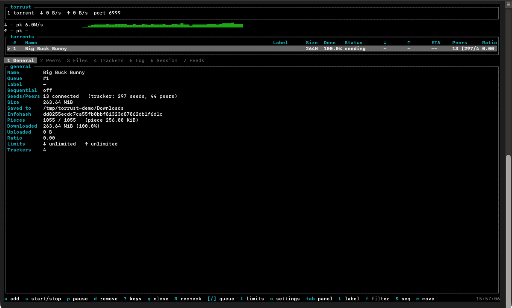
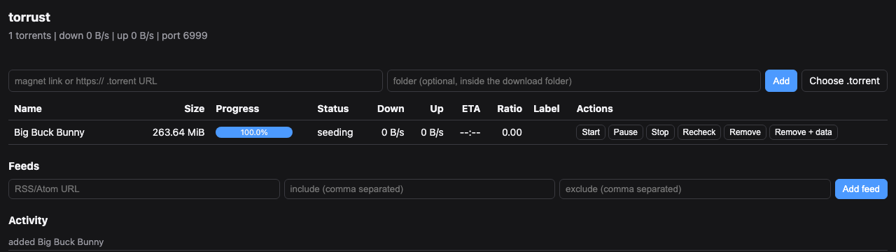
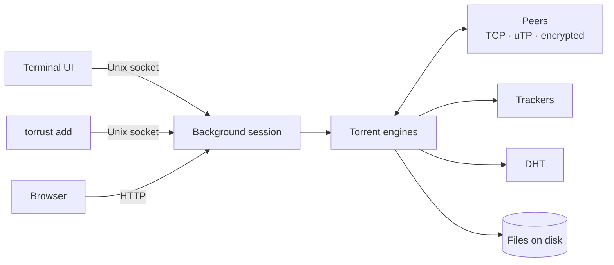

<h1 align="center">torrust</h1>

<p align="center">A free, open-source BitTorrent client written from scratch in Rust, with a terminal UI and a web UI.</p>

<p align="center">
  <a href="https://github.com/KhaiNguyenIUH/torrust/releases/latest"></a>
  <a href="https://github.com/KhaiNguyenIUH/torrust/actions/workflows/release.yml"></a>
  
  <a href="LICENSE"></a>
</p>

torrust runs as a background session that you drive from a terminal UI or a small web UI. Closing either one leaves your downloads running. It speaks the parts of BitTorrent you would expect from a desktop client (trackers, DHT, peer exchange, uTP, encryption, magnet links, RSS) without depending on libtorrent or any other BitTorrent library. The crate is both a library (`torrust`) and a binary.

If you want a lightweight torrent client you can run in a terminal, over SSH or headless on a server, and still open in a browser, it is a free alternative to qBittorrent, Transmission or uTorrent. It runs on macOS and Windows, and on Linux when built from source.

The project is MIT licensed. Bug reports, ideas and pull requests are welcome; see [Contributing](#contributing).

<p align="center">
  
  
</p>

## Install

### Prebuilt binaries

Grab the file for your system from the [latest release](https://github.com/KhaiNguyenIUH/torrust/releases/latest), unpack it and run `torrust`. No Rust toolchain needed.

| System | File | First run |
| --- | --- | --- |
| macOS, Apple Silicon | `torrust-vX.Y.Z-aarch64-apple-darwin.tar.gz` | `xattr -d com.apple.quarantine torrust`, or allow it in System Settings |
| macOS, Intel | `torrust-vX.Y.Z-x86_64-apple-darwin.tar.gz` | same as above |
| Windows 64-bit | `torrust-vX.Y.Z-x86_64-pc-windows-msvc.zip` | SmartScreen warns: "More info", then "Run anyway" |

The binaries are not signed, which is why each system asks once. The Windows build has had less testing than the macOS one, and on Windows the session runs inside the TUI instead of as a background service.

### From source

You need a recent stable Rust toolchain. This is also the way to run torrust on Linux, which has no prebuilt binary yet.

    cargo install --git https://github.com/KhaiNguyenIUH/torrust

or, from a clone:

    cargo build --release      # binary at target/release/torrust

## Quick start

```sh
torrust                                  # open the TUI (starts the background session)
torrust add "magnet:?xt=urn:btih:..."    # add a magnet link or .torrent
torrust webui-password                   # turn on the web UI at http://127.0.0.1:8080
torrust stop                             # stop the session
```

## Features

| | |
| --- | --- |
| Sources | `.torrent` files, magnet links, `http(s)` links to torrents, RSS and Atom feeds |
| Finding peers | HTTP, HTTPS and UDP trackers, Kademlia DHT, peer exchange, local peer discovery |
| Connections | uTP and TCP, Message Stream Encryption (prefer or require), NAT-PMP and UPnP port forwarding |
| Downloading | rarest-first with endgame, resume with recheck, skip files, per-torrent and global speed limits |
| Seeding | seeds while downloading, ratio target, super-seeding, tit-for-tat choking |
| Control | terminal UI with mouse support, web UI with upload and drag-and-drop, schedule, block list, notifications |
| Other clients | import half-finished downloads, including qBittorrent's `.!qB` files |
| Creating | build v1 `.torrent` files on all CPU cores and seed them at once |

## How it fits together



## Usage

    torrust download <file.torrent|magnet:?...> [-o DIR] [--exit-when-done] [--no-tui]
    torrust inspect <file.torrent>
    torrust magnet <uri>            # alias: m
    torrust import <file.torrent> --from DIR [-o DIR] [--mode copy|move|link] [--no-verify] [--start] [--exit-when-done] [--no-tui]

- `download` fetches one torrent. `-o/--output` sets the save directory (default `.`) and `--no-tui` prints progress to stdout. With `--exit-when-done` it quits when the download completes; without it the finished state stays on screen until you press `q`. It stops, and stops seeding, once the download is complete.
- `inspect` prints the parsed torrent without downloading anything.
- `magnet` prints what a magnet URI contains.
- `import` adopts another client's files for the same torrent, so stop that client first. It handles the `.!qB` suffix and layouts without a subfolder, copies, moves or hard-links the files into `-o`, and verifies them unless you pass `--no-verify`. `--start` begins downloading right after.

## Creating torrents

    torrust create <file|dir> [-o out.torrent] [-t URL]... [--web-seed URL]... [--private] \
        [--piece-size KiB] [--comment TEXT] [--source TEXT] [--no-date] [--force] [--seed]

`create` builds a v1 `.torrent` from a file or directory and hashes the pieces on all CPU cores. Files are sorted by path and symlinks are skipped; a symlink given as the input itself is refused. Unless you pass `--piece-size`, the piece size is picked to give about 1000 to 2000 pieces. The output defaults to `<name>.torrent` in the current directory and an existing file is only overwritten with `--force`. The command prints the infohash and a magnet link. With `--seed` the torrent goes to the running session (or is queued) with the parent of `<path>` as its download directory, so seeding starts at once.

## Session mode

    torrust                      # multi-torrent TUI (starts the background service if needed)
    torrust stop                 # stop the background service
    torrust session --no-tui     # headless, prints a summary every few seconds; Ctrl-C quits
    torrust add <file.torrent|magnet:?...> [-o DIR]
    torrust webui-password       # enable the web UI and set its password from stdin

Running `torrust` with no subcommand attaches the TUI to the background session and starts the session first if it isn't running (Unix; the service logs to `torrust.log` in the data directory). `q` or Ctrl-C closes the TUI and leaves downloads and the web UI running. `Q` or `torrust stop` stops the session. On Windows the session runs inside the TUI process instead.

One session runs many torrents behind a single listening port and DHT node. Finished torrents seed until they reach the ratio target (default 2.0, and 0 means seed forever), then stop. The ratio adds up across restarts, and a changed target applies to torrents started after the change.

- `torrust add` hands a torrent to the running session over a Unix socket (`torrust.sock` in the data directory) and starts the background session if none is running. On Windows the torrent is queued and starts the next time `torrust` runs.
- Dropping `.torrent` files onto the TUI, or pasting a magnet link, adds them right away. Inside the add prompt (`a`) a dropped path fills the field instead.
- Settings, torrents and their state live in the data directory: `~/Library/Application Support/torrust` on macOS, `$XDG_DATA_HOME/torrust` (or `~/.local/share/torrust`) on Linux and `%APPDATA%\torrust` on Windows. Set `TORRUST_HOME` to use a different directory.
- Speed limits are in bytes per second (0 means unlimited) and can be set globally or per torrent. Uploads use tit-for-tat choking with 4 unchoke slots plus one optimistic slot, re-evaluated every 10 s.
- The listen port defaults to 6881 and falls back to a free port when that one is busy. With port forwarding on, the session asks the router for it over NAT-PMP, then UPnP. Port, DHT and forwarding changes apply after a restart.
- A magnet link keeps looking for its metadata until it arrives or you stop it. Every tracker in the link, the DHT and peers that connect to you are all used at once, over uTP and TCP. The torrent's status shows how long it has waited and how many trackers and peers it has heard from.
- `scripts/macos` and `scripts/linux` install handlers that open `magnet:` links and `.torrent` files with `torrust add`.

## Encryption and uTP

Session mode prefers encrypted peer connections (Message Stream Encryption) and tries uTP (BEP 29) before TCP, using the same port number over UDP. Both are settings. Encryption is `disabled`, `prefer` (the default, which encrypts when the peer supports it and falls back to plaintext) or `require` (encrypted peers only). The same setting covers fetching magnet metadata. Single-torrent `torrust download` uses plaintext TCP. Changes apply after a restart.

## RSS feeds

You can subscribe to RSS or Atom feeds over `http(s)`. Items whose title matches your include and exclude words (case-insensitive) are added automatically, into the feed's folder if it has one. Feeds are polled every 15 minutes, or when you refresh them.

- Items already in the feed when you subscribe are skipped, and only later items are downloaded. The session logs `watching N existing items`.
- Feeds and the items already seen are stored in `feeds.bencode` in the data directory, so a restart never adds anything twice.
- A session also accepts an `http(s)` link to a `.torrent` (up to 10 MiB). Feed items and the web UI's add box deliver torrents this way, and `torrust add` takes them too. Links, feeds, redirects and web seeds that resolve to loopback, private (LAN), link-local, CGNAT or other non-public addresses are refused with "address not allowed" unless you turn on "Allow local network URLs" in settings (`allow_local_urls`). Peers on those addresses learned through peer exchange are skipped too, and local peer discovery only accepts announces from your own network.

## Block list, schedule and notifications

- Block list: set `blocklist` in the settings to a text file of IP ranges. It reads PeerGuardian `name:1.2.3.4-1.2.3.9`, eMule `1.2.3.4 - 1.2.3.9 , 100 , name` and plain `a-b` lines, IPv4 and IPv6, with `#` comments. Gzip is not supported. Inbound connections from listed addresses are dropped before the handshake. Running torrents pick up a new list after they restart. Load results and skipped lines go to the log, and a missing file is logged as an error with no list applied.
- Schedule: a 7x24 grid of slots. `normal` runs as usual, `limited` uses the schedule's own down/up limits, `seedonly` pauses downloads and keeps seeding, and `off` stops every torrent. Rules read `<days> <HH-HH> <slot>`, for example `weekdays 09-18 limited`, `sat,sun 00-24 normal` or `mon-fri 22-06 off`. The end hour is exclusive and a start after the end runs past midnight. Days are `mon` to `sun`, ranges such as `fri-mon`, lists, `weekdays`, `weekend` or `all`. Times use the UTC offset stored with the schedule, taken from the system on first start. When a slot ends, only the torrents the schedule paused or stopped are resumed; ones you paused or stopped yourself stay that way. Slot changes are logged.
- Notifications: a desktop notification appears when a torrent finishes downloading (`osascript` on macOS, `notify-send` on Linux if it is installed, nothing on Windows). Turn it off with `notifications` in the settings. Torrents that were already complete when the session started don't notify.
- Super-seeding: when you are the first seeder of a torrent, `SetSuperSeed` makes the engine reveal pieces one peer at a time, so each uploaded piece spreads before the next is offered. The setting is kept per torrent across restarts.
- Trackers: `AddTracker` and `RemoveTracker` change a running torrent's tracker list. The changed list is saved and replaces the one from the .torrent on restart. Stopped torrents ignore the command.
- Peer flags: `E` encrypted, `P` uTP, `I` incoming, `X` found via PEX, `L` local discovery, `H` DHT, `F` fast extension, `W` web seed.

## Web UI

The session has a small browser interface, off by default.

- Without a password it listens on `127.0.0.1` only and needs an access token. The session creates a random 128-bit token, keeps it in `webui.token` in the data directory (readable only by you), and logs the one-time URL `http://127.0.0.1:PORT/?token=...`, which `torrust session` also prints at startup. Opening that URL stores the token in an HttpOnly cookie and redirects to `/`. Scripts can send `Authorization: Bearer <token>` instead.
- With a password it still listens on `127.0.0.1` only and asks for the password (HTTP Basic, any user name) on every request. The `Host` header must be an IP address or `localhost`, which blocks DNS rebinding. After five wrong passwords from one address it answers 429 for a growing time, up to 15 minutes.
- The settings screen has "Web UI on LAN (needs password)" (`webui_lan`). Only with that on and a password set does it listen on all interfaces, and the session logs a warning when it does, because the connection is plain HTTP. To reach it from another machine, an SSH tunnel is safer than LAN mode: `ssh -L 8080:127.0.0.1:8080 host`, then open `http://127.0.0.1:8080/` locally. If you need to expose it further, put a reverse proxy with TLS in front.
- Besides links and magnets it takes a `.torrent` file from the "Choose .torrent" button or dropped anywhere on the page (up to 10 MiB, sent as raw bytes to `POST /api/upload`).
- The optional folder box sets where an add, upload or drop is saved. A plain name such as `Movies/2024` is a subfolder of the download folder and is created if missing. A full path is accepted only inside the download folder or inside one of the "Web UI extra save folders" from the TUI settings (`webui_save_roots`, separated by `;`, e.g. `/Volumes/Media`). That lets the browser reach another drive without reaching an arbitrary place. `..`, backslashes and links that point outside an allowed folder are refused, and a refused folder is never created.
- To enable it and set the password without leaving it in shell history:

      torrust webui-password        # type the password and press Enter
      torrust session --no-tui      # daemon mode: runs headless, serves the web UI, Ctrl-C quits

  The password is stored only as a salted, iterated SHA-1 hash (`torrust-sha1$100000$salt$hash`) in `settings.bencode`, which only you can read. The default port is 8080 (`webui.port` in the settings), and the session logs the URL it listens on. `webui-password` refuses to run while a session is running, because the session writes its own settings when it quits.
- Settings, feeds and web UI changes made while the session runs are saved immediately and take effect after a restart.

## TUI keys

| Key | Action |
| --- | --- |
| `q`, `Esc`, `Ctrl-C` | quit |
| `Tab` | switch focus between peers and files |
| `j`/`Down`, `k`/`Up` | move selection |
| `Space` | skip or re-want the selected file (files pane) |
| `p` | pause / resume |
| `PgUp`/`PgDn`, `Home`/`End` | scroll the log |
| `?` | toggle help |
| `r` | redraw |

In the multi-torrent session UI, mouse clicks (torrent rows, tabs, footer key hints, list rows) and the wheel work too. Mouse capture takes over plain drags, so to select text hold Shift (Windows Terminal, most Linux terminals) or Option/Fn (macOS Terminal/iTerm).

## Logging

Logging uses `tracing`. Set the level with `RUST_LOG` (default `torrust=info,warn`), e.g. `RUST_LOG=torrust=debug`. In TUI mode the logs go to `torrust.log` in the data directory so they don't garble the display. The file is owner-only (mode 0600), and a symlink in its place is refused. With `--no-tui` they go to stderr.

## Project layout

- `bencode`: bencode encoding and decoding
- `metainfo`: `.torrent` parsing, infohash, magnet URIs
- `storage`: maps the payload onto files; SHA-1 piece checks
- `peer`: wire protocol (`wire`), per-peer connections (`connection`), peer pool and listener (`pool`), encryption (`mse`), peer exchange (`pex`)
- `utp`: uTP transport (BEP 29)
- `tracker`: HTTP/HTTPS/UDP announces
- `dht`: Kademlia DHT and metadata exchange
- `scheduler`: rarest-first piece selection, endgame
- `engine`: ties the pieces above together for one torrent
- `session`: many torrents behind one port, settings, feeds, schedule
- `state`: snapshots and commands shared with the UIs
- `tui`, `webui`: the terminal and browser interfaces
- `import`: adopting other clients' partial downloads
- `create`: building `.torrent` files

## Contributing

Contributions of any size are welcome, from typo fixes to protocol work.

- **Bugs and ideas**: open an [issue](https://github.com/KhaiNguyenIUH/torrust/issues). For a bug, include your OS, the torrust version (`torrust --version`), what you did and what you expected. A log helps a lot: run with `RUST_LOG=torrust=debug` and attach `torrust.log` from the data directory, after removing anything private.
- **Pull requests**: keep each one to a single change, add or update a test when you change behaviour, and run the checks below before you push. For larger changes, open an issue first so we can agree on the approach.
- **Style**: follow the code around you. Format with `cargo fmt` on the lines you touch and keep `cargo clippy` free of new warnings.

Checks:

    cargo test
    cargo clippy --all-targets

The integration tests in `tests/` run the real engine against local seeders and mock trackers, so they need no internet access. One of them, `peers_find_each_other_through_local_discovery_alone`, needs local-network multicast and can fail on machines or CI runners that block it.

## License

torrust is released under the [MIT License](LICENSE).
